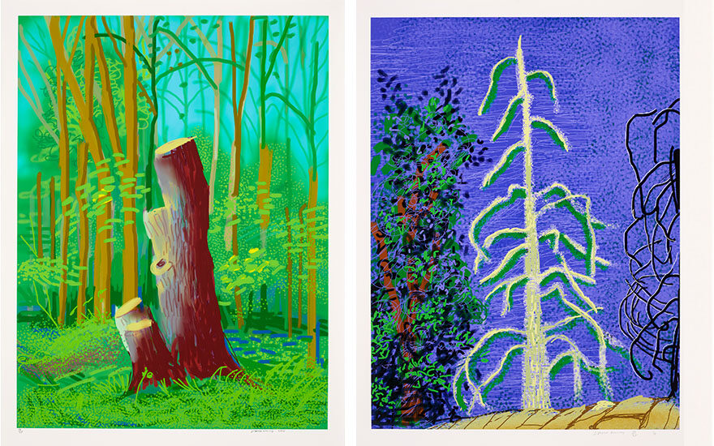
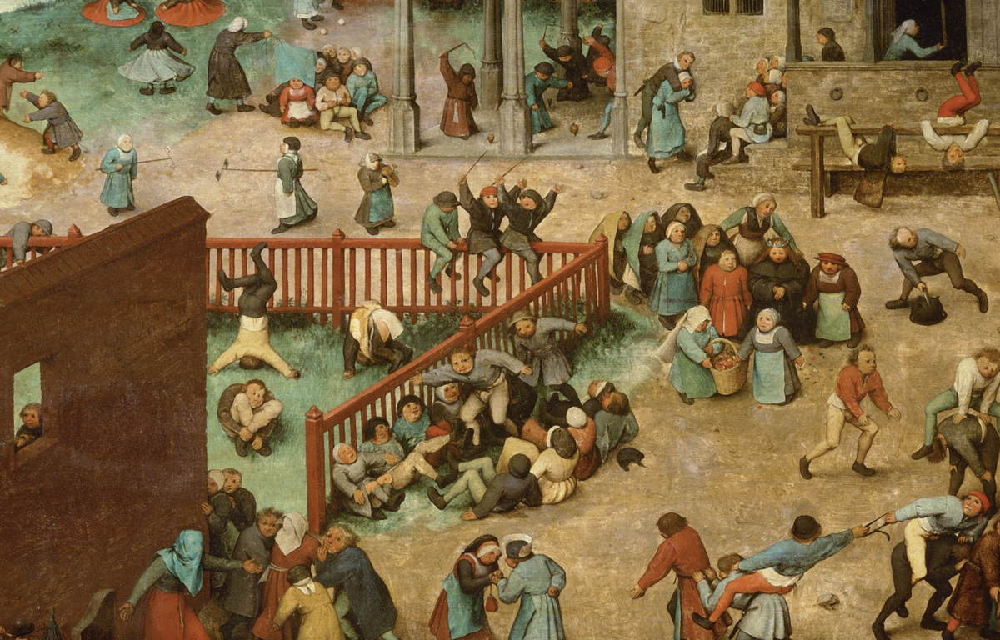
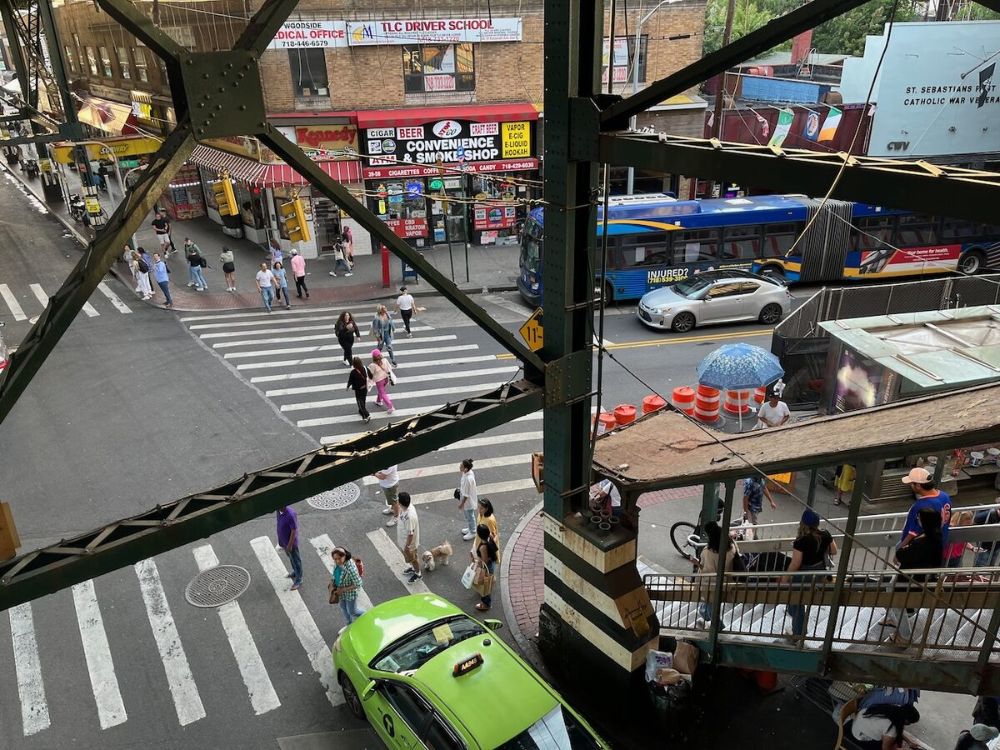
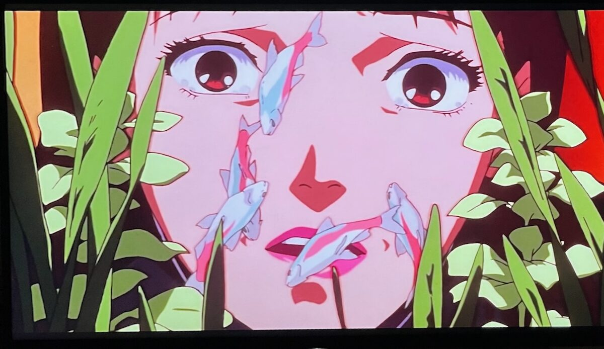
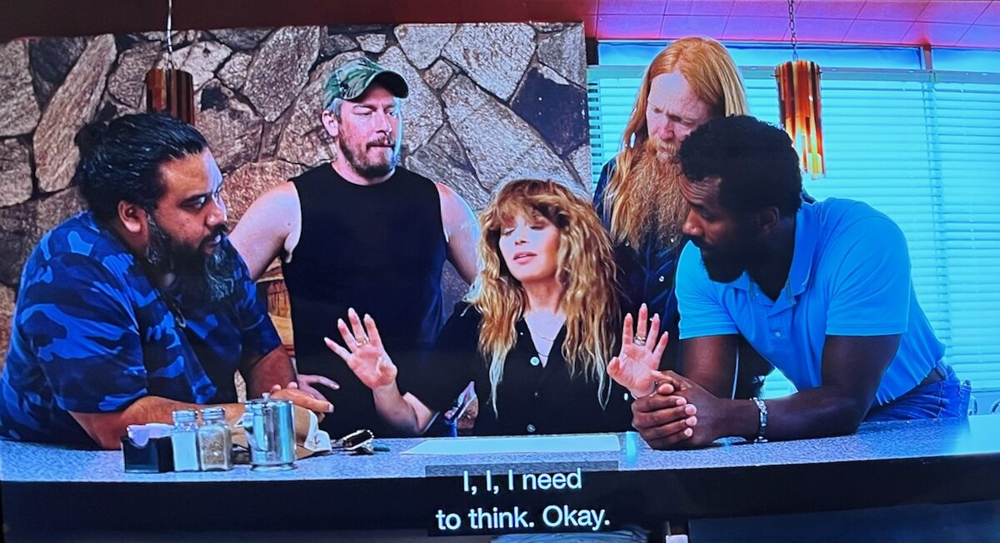

# September 6, 2023

Hello! Welcome to Zoom Zoom Drawing Club. As usual, feel free to draw whatever you want, however you please.

If you’d like some prompts, below are some images that have been on my mind. 🤓

Click on each image to see a larger version.

<ul class="reference-photos">
  <li>
    
    David Hockney's <a href="https://www.hockney.com/works/digital/ipad">iPad drawings</a>
  </li>
  <li>
    
    <a href="https://artsandculture.google.com/asset/CQEeZWQPOI2Yjg">Children's Games</a> by Pieter Bruegel
  </li>
  <li>
    
    Woodside, Queens NY
  </li>
  <li>
    
    <a href="https://en.wikipedia.org/wiki/Perfect_Blue">Perfect Blue</a>, by Satoshi Kon
  </li>
  <li>
    
    <a href="https://en.wikipedia.org/wiki/Poker_Face_(TV_series)">Poker Face</a>, Ep 2
  </li>
</ul>

See you next time. 😄

<a href="https://mrshawnliu.com">✌</a>

