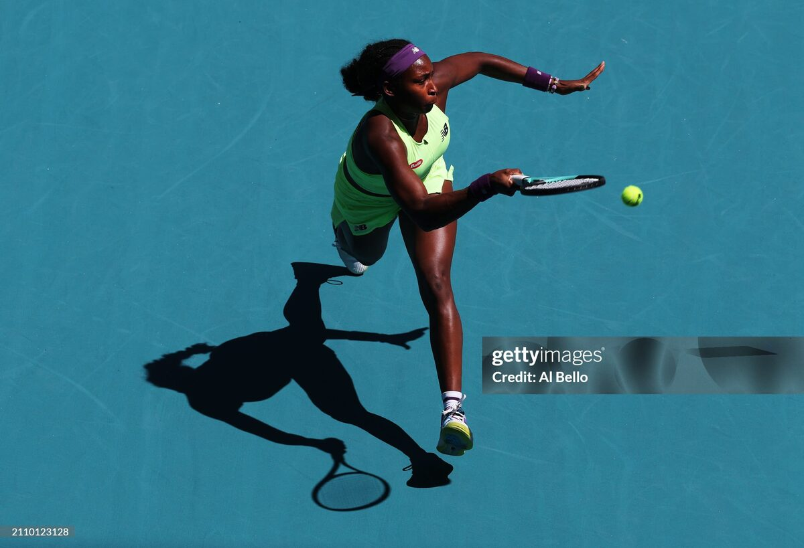
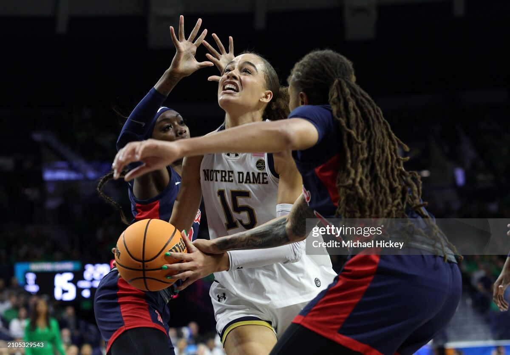
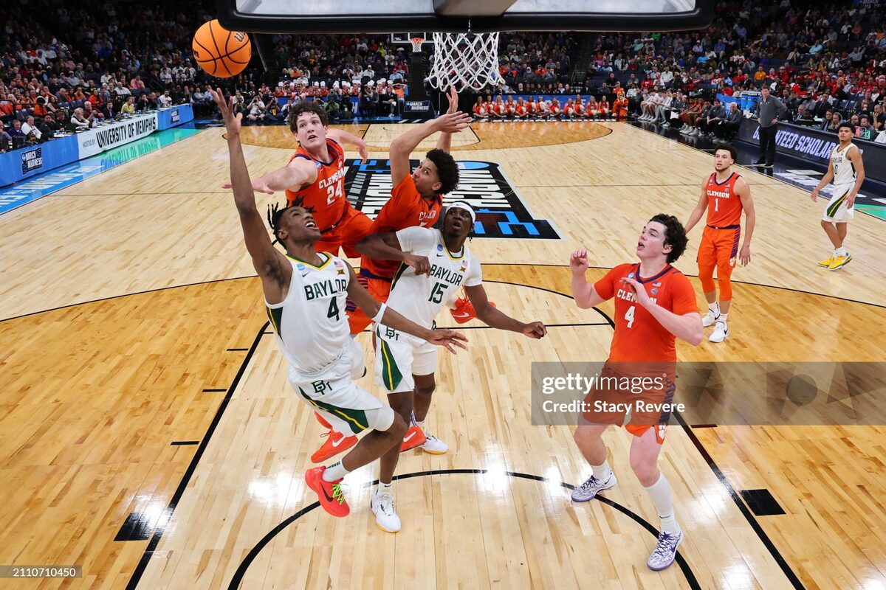
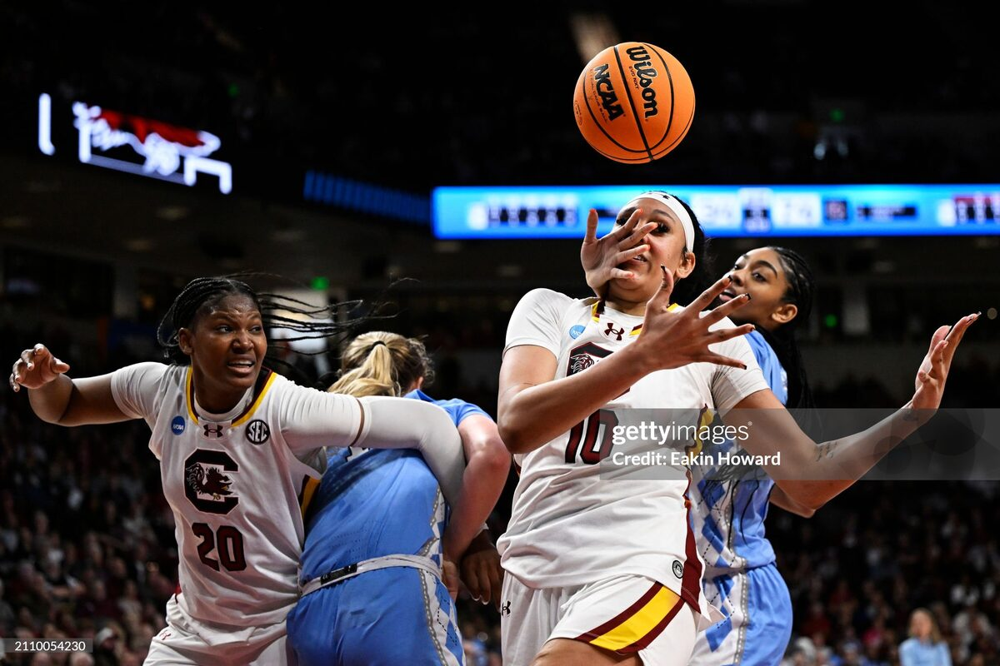

# March 27, 2024

Hello! Welcome to Zoom Zoom Drawing Club. As usual, feel free to draw whatever you want, however you please.

If you’d like some reference photos, I've been practicing figure drawing lately and here are some pictures I found online.

(Click on each image to see a larger version.)

<ul class="reference-photos">
  <li>
    
    Coco Gauff
  </li>
  <li>
    
    Carlos Alcaraz
  </li>
  <li>
    
    NCAA: Notre Dame vs Ole Miss
  </li>
  <li>
    
    NCAA: Baylor vs Clemson
  </li>
  <li>
    
    NCAA: North Carolina vs South Carolina
  </li>
</ul>

Thanks for joining Zoom Zoom today! See you next time. 😄

<a href="https://mrshawnliu.com">✌</a>

