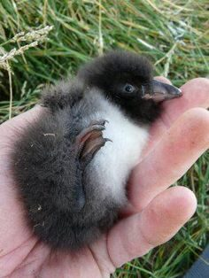
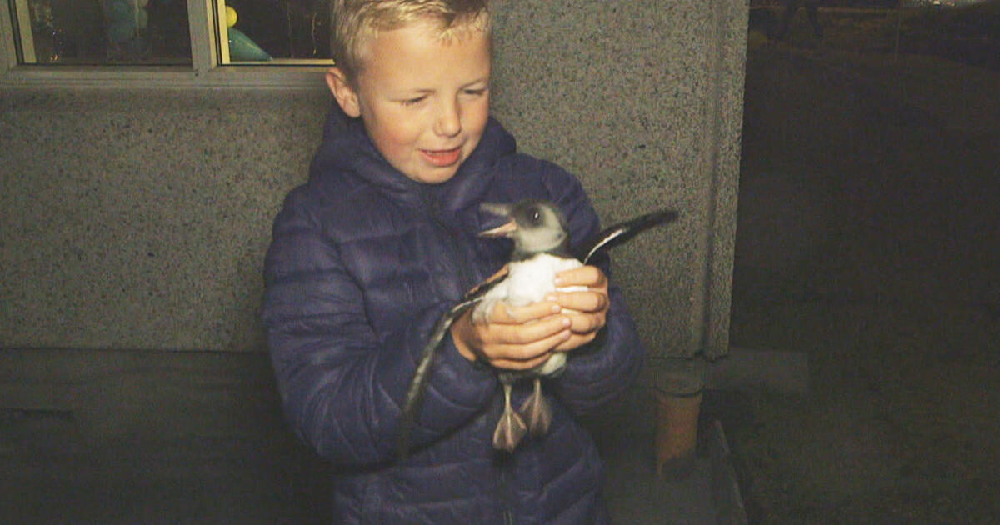
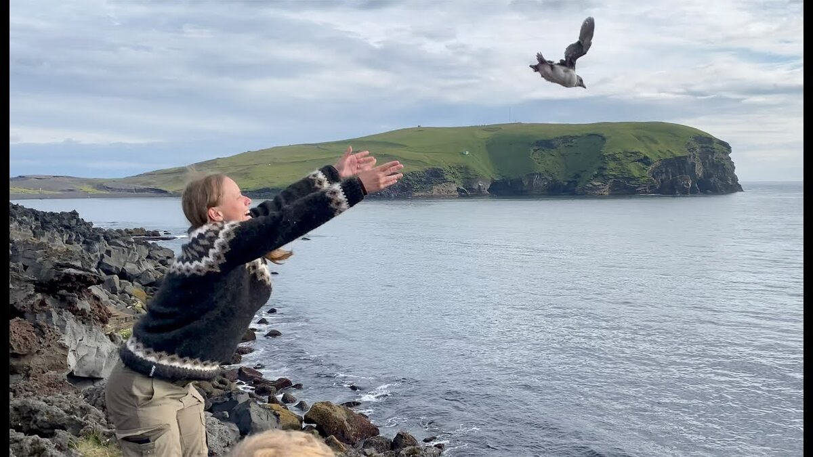
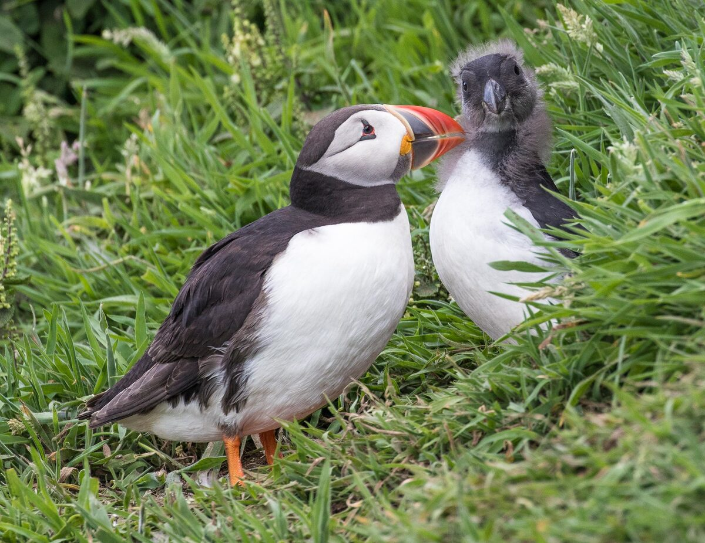
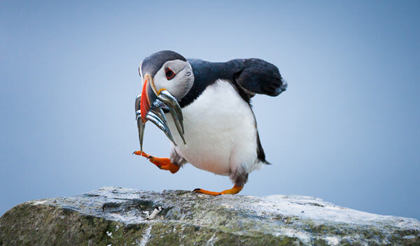
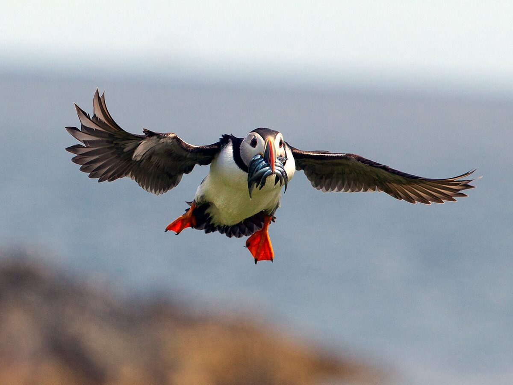
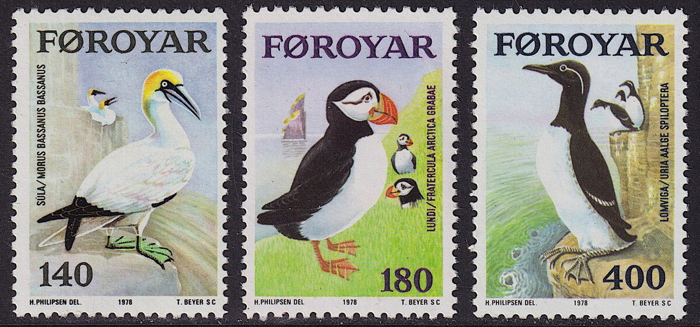

# September 5, 2024

Hello! Welcome to Zoom Zoom Drawing Club. As usual, feel free to draw whatever you want, however you please.

If you’d like a drawing prompt or reference, I've found some pictures of puffins and baby puffins, known as <em>pufflings</em>. Last week, I listened to a <a href="https://www.nytimes.com/2024/05/30/podcasts/animal-episode-2-puffins.html">fascinating podcast</a> about rescuing pufflings, and I've been thinking about them ever since. The podcast, titled <a href="https://www.nytimes.com/column/animal-podcast"><em>Animal</em></a>, is hosted by Sam Anderson and produced by Kaitlin Roberts. I recommend it!

(Click on each image to see a larger version.)

<ul class="reference-photos">
  <li>
    
    This is a tiny puffling.
  </li>
  <li>
    
    
      Baby pufflings often get lost, but fortunately some kind-hearted people would help the young birds out. (<a href="https://www.cbsnews.com/news/a-childrens-puffin-rescue-squad-heimaey-island-iceland/">CBS news</a>)
    
  </li>
  <li>
    
    
      People help by throwing the pufflings off of a cliff. This is a tradition in <a href="https://en.wikipedia.org/wiki/Vestmannaeyjar">Vestmannaeyjar</a>, an island off the coast of Iceland.
    
  </li>
  <li>
    
    Here's a picture of a puffin with a puffling.
      I found this picture on flickr. Remember flickr!?
      (Photo by <a href="https://www.flickr.com/photos/welshtrail/27770145134/">Jan Hannaford</a>)
  </li>
  <li>
    
    
      Once a puffling grows up, we call it a puffin.
      A puffin can carry many small fish in its beak, thanks to a <a href="https://www.birdnote.org/listen/shows/all-those-fish-puffins-beak">stretchy skin at the beak hinge</a>.
    
  </li>
  <li>
    
    Puffins are impressive flyers. They can fly up to 55mph. 
      (Photo by <a href="https://www.flickr.com/photos/canon_chas/9193713129/">Chas Moonie</a>)
    
  </li>
  <li>
    
    
      <a href="https://en.wikipedia.org/wiki/Faroe_Islands">Faroese</a>
      stamps from 1978. From left to right: <a href="https://en.wikipedia.org/wiki/Gannet">gannet</a>, puffin, and <a href="https://en.wikipedia.org/wiki/Guillemot">guillemot</a>.
    
  </li>

</ul>

Thanks for joining Zoom Zoom today! See you next time. 😄

<a href="https://mrshawnliu.com">✌</a>

