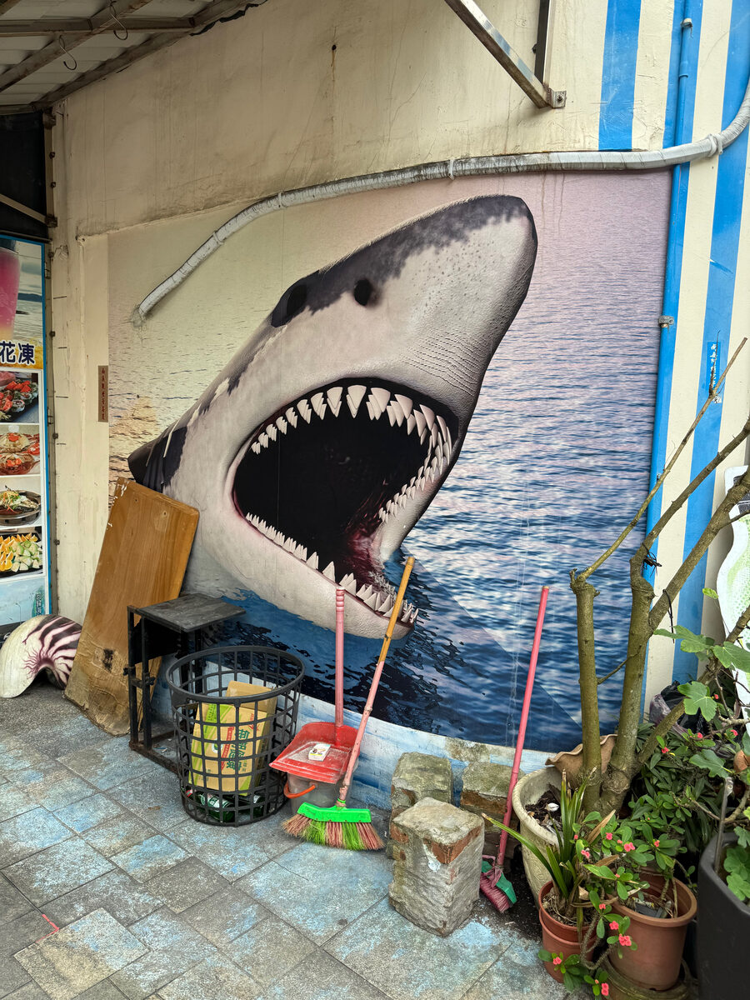
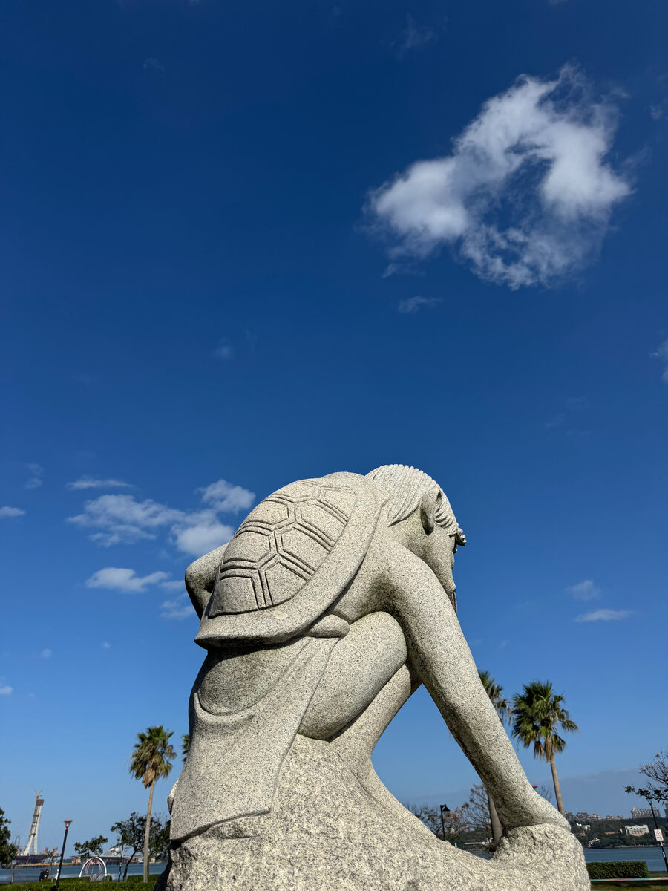
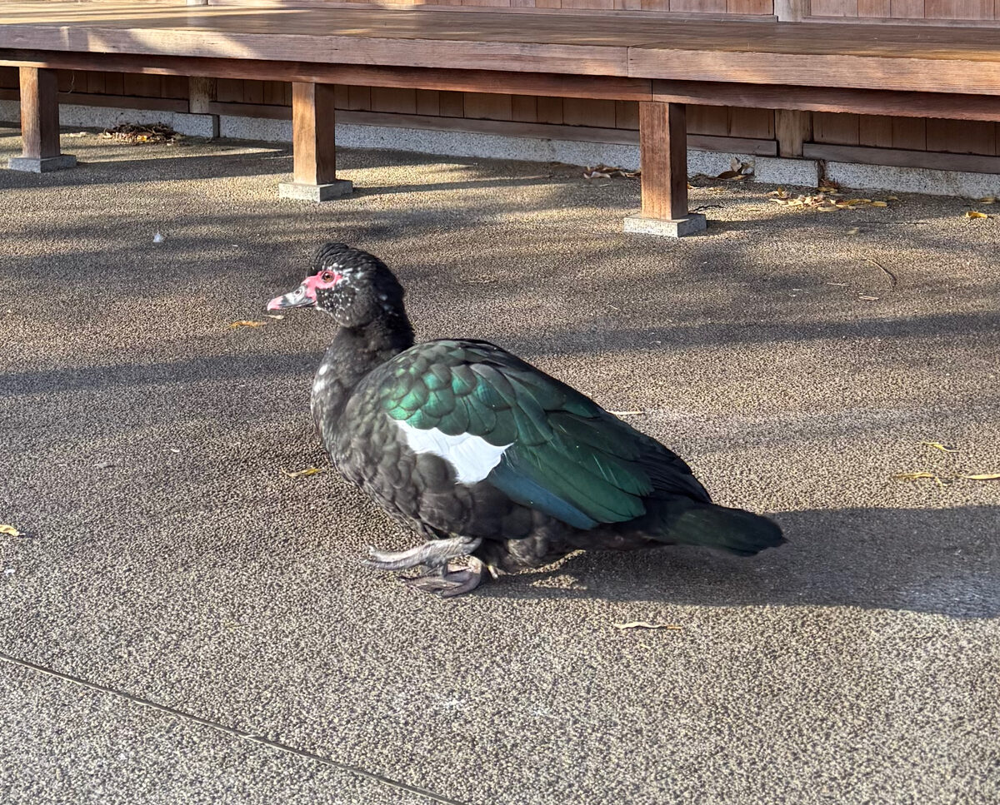
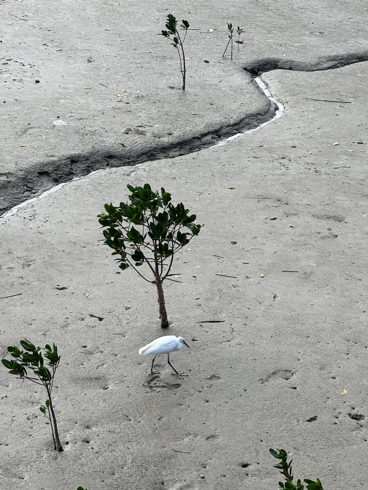
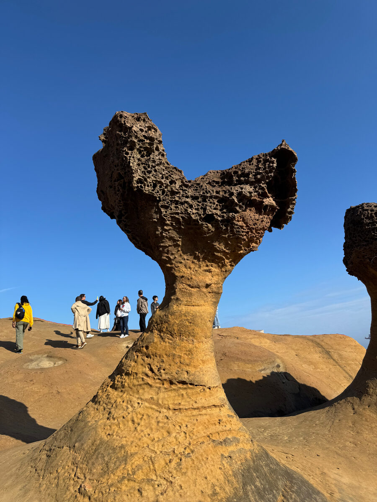
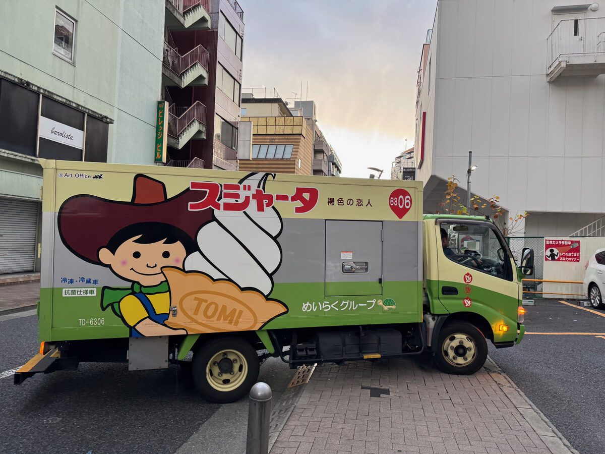

# January 16, 2025

Hello and welcome to Zoom Zoom Drawing Club! As always, you're free to draw whatever you like, in any style you please.

If you’re looking for some prompts, here are a few photos from my recent Asia trip.

(Click on each image to see a larger version.)

<ul class="reference-photos">
  <li>
    
    Shark on a wall!
    
  </li>
  <li>
    
    
      Status of a <a href="https://en.wikipedia.org/wiki/Kappa_(folklore)">Kappa</a>, found in <a href="https://en.wikipedia.org/wiki/Bali_District">Bali, Taiwan</a>.
    
  </li>
  <li>
    
    
      A <a href="https://en.wikipedia.org/wiki/Muscovy_duck">Muscovy Duck</a> hanging out at Hinokicho Park, Tokyo.
    
  </li>
  <li>
    
    
      An egret at Guandu Wharf, Taiwan.
    
  </li>
  <li>
    
    
      <a href="https://en.wikipedia.org/wiki/Yehliu_Geopark">Yehliu Geopark</a>, Taiwan.
    
  </li>
  <li>
    
    
      I like this ice cream truck (saw in Tokyo).
    
  </li>
</ul>

