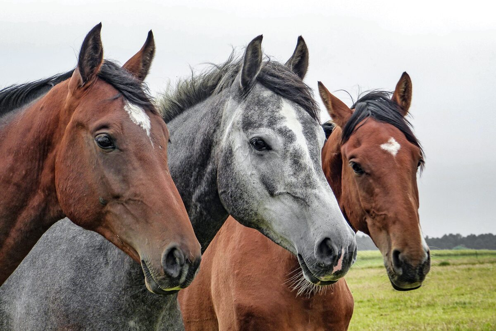
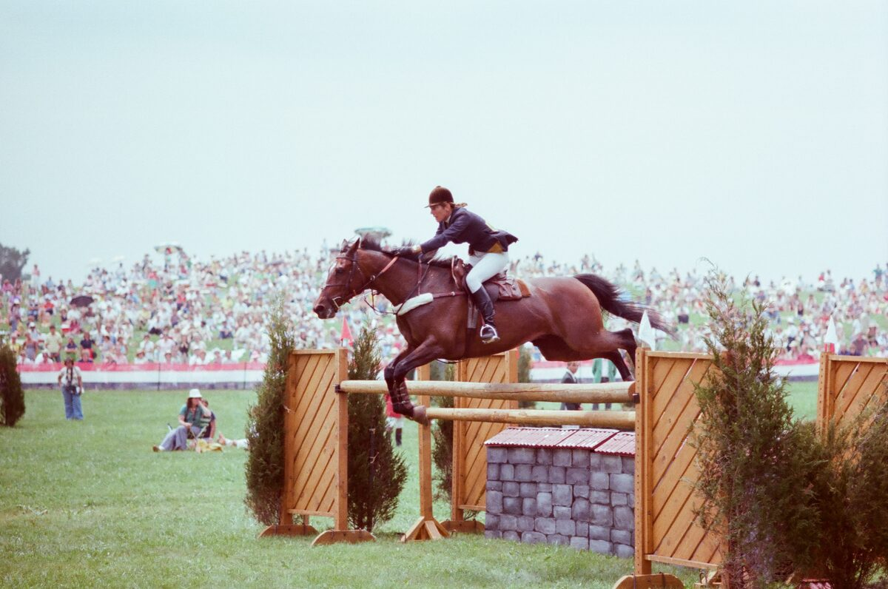
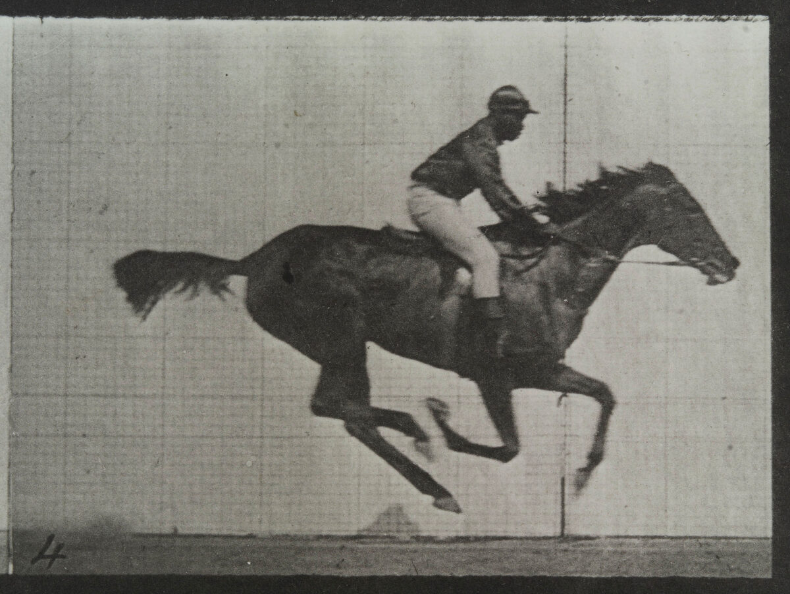
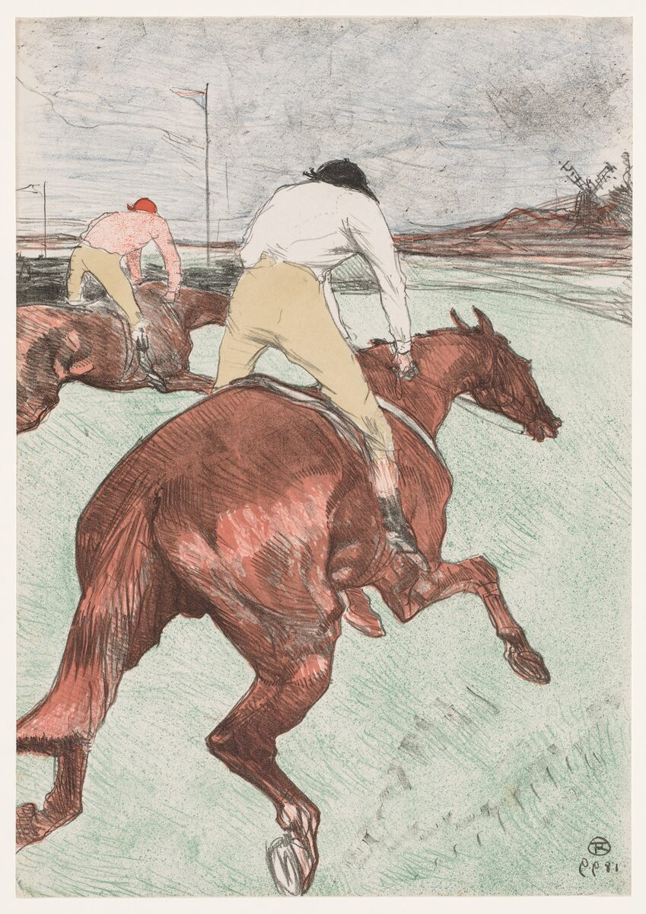
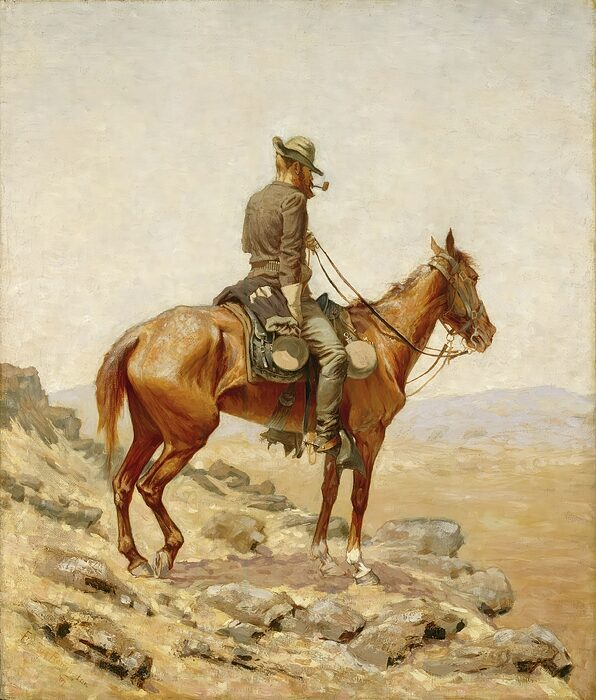
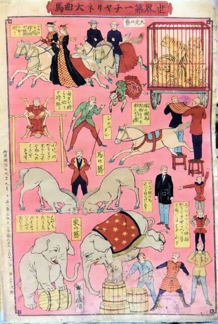

# March 13, 2025

Hello and welcome to Zoom Zoom Drawing Club! As always, you're free to draw whatever you like, in any style you please.

If you’re looking for some prompts, here are some pictures of horses that I've found on the internet.

(Click on each image to see a larger version.)

<ul class="reference-photos">
  <li>
    
    
      Three horses.
    
  </li>
  <li>
    
    
      <a href="https://archive.org/details/terry-rudd-and-horse-semi-tough-1979">Terry Rudd and Horse</a>
    
  </li>
  <li>
    
    
      <a href="https://wellcomecollection.org/works/uwc8xuuu">A galloping horse and rider</a>, by Eadweard Muybridge.
    
  </li>
  <li>
    
    
      <a href="https://archive.org/details/clevelandart-1967.234-the-jockey">The Jockey</a>, by Henri de Toulouse-Lautrec.
    
  </li>
  <li>
    
    
      <a href="https://artsandculture.google.com/asset/the-lookout-frederic-remington/OwEvfSllP9t7cA?hl=en">The Lookout</a>, by Frederic Remington.
    
  </li>
  <li>
    
    
      <a href="https://ameblo.jp/rinaogawa1994/entry-12836094659.html">Old Japanese poster</a>, not sure what the story is. 😅
    
  </li>
</ul>

